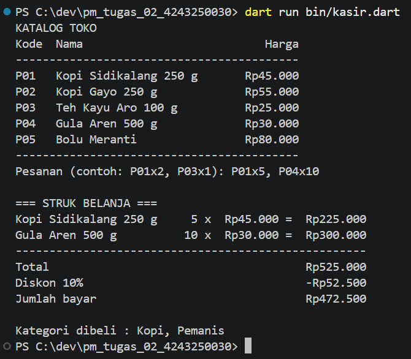
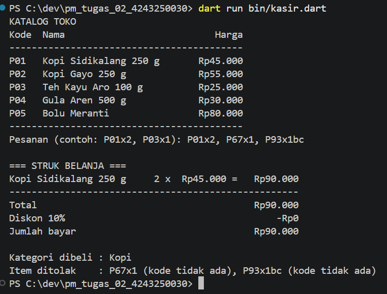

# Tugas Rutin 2: Aplikasi Console Kasir Sederhana

Pertemuan 2, Pemrograman Mobile

## Identitas

- Nama : Alya Namira
- NIM : 4243250030
- Kelas : PSIK24D

## Screenshot

### Skenario 1: Pesanan valid

Input: `P01x5, P04x10`

### Skenario 2: Pesanan tidak valid

Input: `P01x2, P99x1, P03xabc`

## Penjelasan: var, final, const, dan Null Safety

`var`, `final`, dan `const` sama-sama dipakai untuk menyimpan nilai, tetapi aturannya berbeda. `var` dipakai untuk variabel yang nilainya boleh berubah. `final` hanya boleh diisi sekali, dan nilainya baru boleh diketahui saat program berjalan, misal `final String input = stdin.readLineSync() ?? '';`. `const` nilainya harus pasti saat kode dikompilasi dan tidak bisa diubah. Di program ini hampir semua variabel memakai `final` karena nilainya tidak berubah setelah diisi.

Null safety mencegah crash karena compiler memaksa saya menangani nilai yang mungkin kosong. Contohnya `katalog[kode]` bernilai nullable, sehingga saya wajib mengecek `if (produk == null)` sebelum memakainya, dan kode yang salah dicatat ke daftar item ditolak. Begitu juga `int.tryParse` yang mengembalikan `int?`, jadi jumlah yang bukan angka tidak membuat program berhenti. Operator `!` hanya saya pakai pada `katalog[v.kode]!` di bagian `map`, karena kode tersebut sudah divalidasi pada perulangan sebelumnya.

## Pernyataan Penggunaan AI

Saya menggunakan AI untuk membantu menyusun kode `bin/kasir.dart` agar lebih rapi berdasarkan kerangka dari modul dan untuk memahami cara kerja null safety, `tryParse`, dan juga `map`/`fold`. Saya membaca dan memahami setiap bagian kode, menjalankannya sendiri, serta menguji dua skenario yang diberikan.